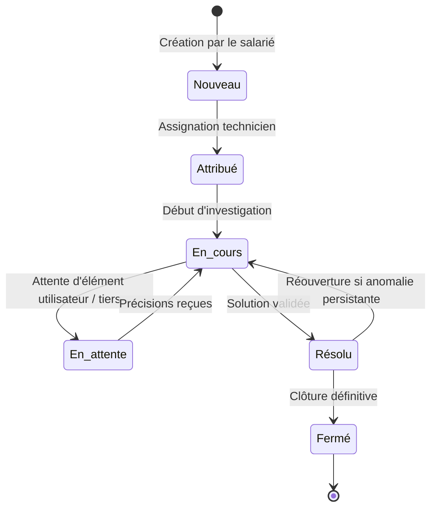
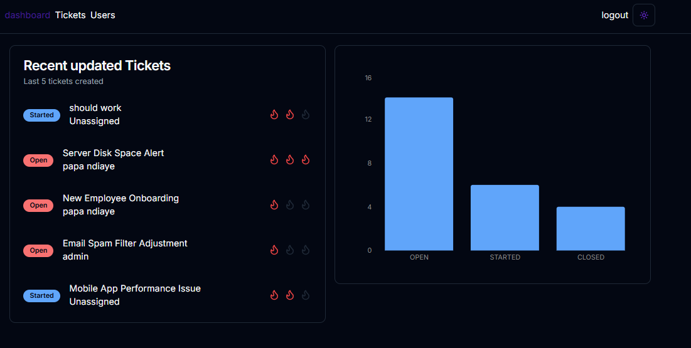
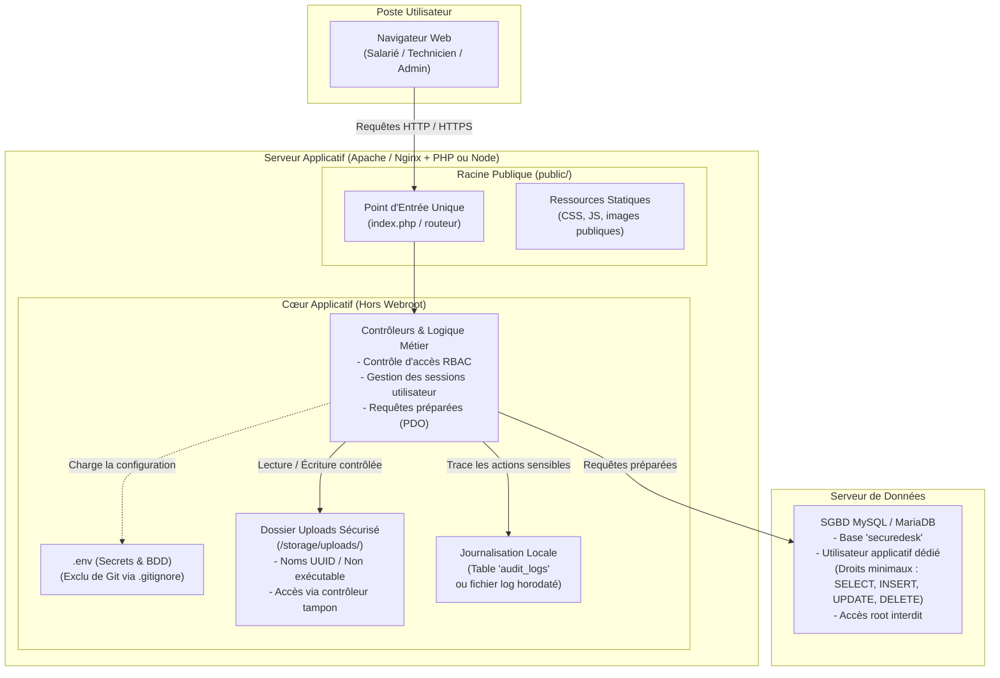

# SecureDesk — Application de Gestion de Tickets Sécurisée

[](https://owasp.org)
[](https://www.cnil.fr)
[](https://github.com)
[](https://github.com)

**SecureDesk** est une plateforme web d'assistance technique interne développée pour les collaborateurs de **NOVATECH SERVICES** (180 salariés). Elle centralise les déclarations d'incidents, optimise le travail des techniciens de support et intègre dès sa conception les exigences de **cybersécurité** (*Security by Design*) et de **protection de la vie privée** (*Privacy by Design*).

---

## 📑 Sommaire

1. [Présentation & Périmètre Métier](#-présentation--périmètre-métier)
2. [Rôles & Habilitations (RBAC)](#-rôles--habilitations-rbac)
3. [Cycle de Vie d'un Incident](#-cycle-de-vie-dun-incident)
4. [Aperçu de l'Interface](#-aperçu-de-linterface)
5. [Architecture Technique Cible (V1)](#-architecture-technique-cible-v1)
6. [Exigences Techniques & Sécurité](#-exigences-techniques--sécurité)
7. [Politique des Données & RGPD](#-politique-des-données--rgpd)
8. [Feuille de Route & Issues GitHub](#-feuille-de-route--issues-github)
9. [Arborescence du Dépôt](#-arborescence-du-dépôt)

---

## 🏢 Présentation & Périmètre Métier

L'application remplace les canaux informels (téléphone, e-mails directs, messageries instantanées) pour apporter :
* **Centralisation & Traçabilité** : Aucun incident oublié, historique horodaté et assignation univoque.
* **Ségrégation des Accès** : Cloisonnement strict entre demandeurs, techniciens et administrateurs.
* **Sécurité des Échanges** : Chiffrement systématique, contrôle strict des pièces jointes et protection contre les attaques web courantes.

---

## 👥 Rôles & Habilitations (RBAC)

| Rôle | Périmètre et Droits applicatifs |
| :--- | :--- |
| **Utilisateur (Salarié)** | Création d'un ticket, choix de catégorie, description du besoin, ajout de pièces jointes autorisées, consultation de ses propres demandes et ajout de réponses/commentaires. |
| **Technicien Support** | Visualisation de la file des tickets assignés, traitement des incidents, changement d'état, rédaction de notes techniques internes, clôture des demandes. |
| **Administrateur Applicatif** | Gestion des comptes (activation/désactivation), attribution des rôles, paramétrage des catégories de tickets, consultation des journaux d'audit applicatifs. |
| **Équipe DevOps / Dev** | Maintenance du code source, gestion de la CI/CD et déploiements sur environnements cloisonnés (sans accès direct aux données de production). |

---

## 🔄 Cycle de Vie d'un Incident



---

## 🖥️ Aperçu de l'Interface

| Module | Aperçu |
| :--- | :--- |
| **Tableau de Bord**<br>Métriques clés, tickets en cours et répartition des urgences |  |
| **Suivi des Demandes**<br>Filtres par statut, catégorie, priorité et assignation |  |
| **Traitement d'un Incident**<br>Échanges avec le demandeur, historique et notes d'intervention |  |
| **Gestion des Utilisateurs**<br>Annuaire interne et contrôle des rôles d'accès |  |

---

## 🏗️ Architecture Technique Cible (V1)

Pour répondre aux vulnérabilités identifiées dans le système initial (connexion en `root` MySQL, transmission en clair HTTP, uploads exécutables dans le webroot, identifiants dans Git), l'architecture cible V1 repose sur un modèle clair, sécurisé et directement réalisable dans un environnement de développement étudiant (LAMP, LEMP ou Docker Compose) :



---

## 🛡️ Exigences Techniques & Sécurité (Security by Design)

Toute contribution au projet doit obligatoirement respecter les règles suivantes, alignées sur le programme **Bloc 3 — Cybersécurité** :

1. **Moindre privilège sur la base de données** :
   * Ne jamais utiliser le compte `root` dans l'application.
   * Créer un utilisateur MySQL dédié (`securedesk_user`) disposant uniquement des privilèges nécessaires (`SELECT`, `INSERT`, `UPDATE`, `DELETE`).
2. **Requêtes préparées systématiques** :
   * Utilisation exclusive de requêtes SQL préparées (`prepare()` et `execute()` via PDO ou ORM). 
   * Interdiction stricte de toute concaténation de variables dans les requêtes (protection contre les injections SQL).
3. **Contrôle d'accès strict côté serveur (RBAC)** :
   * Chaque page, action et point d'API vérifie la session et les droits du demandeur côté serveur (pas de simple masquage d'éléments en HTML/CSS/JS).
   * Vérification des autorisations pour éviter les accès directs aux données d'un tiers (prévention des failles IDOR / BOLA).
4. **Téléversement de fichiers étanche** :
   * Stockage des pièces jointes **strictement en dehors de la racine publique** (`/storage/uploads/`).
   * Renommage automatique à l'enregistrement avec un identifiant aléatoire (UUID ou hash) pour éviter tout risque d'écrasement ou d'exécution directe.
   * Validation stricte côté serveur de l'extension et du type MIME (whitelist : `.pdf`, `.png`, `.jpg`).
   * Téléchargement servi uniquement via un script tampon vérifiant que l'utilisateur a le droit d'accéder au ticket concerné.
5. **Gestion des secrets & Mots de passe** :
   * Hachage robuste des mots de passe via `password_hash()` avec algorithme standard (**Bcrypt** ou **Argon2id**).
   * Les mots de passe et clés secrètes ne sont jamais écrits en dur dans le code : ils résident dans un fichier `.env`, ignoré par Git (`.gitignore`). Un fichier `.env.example` sans données secrètes est fourni.
6. **Journalisation & Traçabilité (Audit)** :
   * Enregistrement horodaté des événements clés (authentification réussie/échouée, changement de rôle, clôture de ticket, suppression) dans une table `audit_logs` ou un fichier log interne.
7. **Protection contre les failles Web usuelles** :
   * Échappement systématique des données affichées (`htmlspecialchars()`) pour neutraliser les attaques XSS.
   * Protection des formulaires sensibles contre les attaques CSRF par jeton de session.

---

## 🔒 Politique des Données & RGPD (Privacy by Design)

Conformément au principe de **minimisation des données** (Art. 5 RGPD) :

* **Données autorisées :** Nom, prénom, adresse e-mail professionnelle, service/département, rôle applicatif et informations techniques nécessaires au ticket.
* **Données strictement exclues :** Numéro de sécurité sociale (NIR), copie de pièce d'identité, coordonnées personnelles (téléphone personnel, domicile) et géolocalisation.
* **Politique de conservation et purge :**
  * Tickets résolus et fermés : Anonymisation ou archivage après 12 mois.
  * Pièces jointes : Suppression automatique après un délai défini post-clôture (ex: 3 mois).
  * Salariés ayant quitté l'entreprise : Désactivation immédiate du compte et purge/anonymisation planifiée.

---

## 📋 Feuille de Route du Projet

Le développement est organisé par étapes claires, pouvant faire l'objet de jalons ou d'Issues GitHub :

* **Étape 1 — Socle & Données :** Modélisation de la base de données (MCD/MLD), scripts de création de tables, création de l'utilisateur MySQL dédié et gestion du fichier `.env`.
* **Étape 2 — Authentification & RBAC :** Formulaires de connexion/déconnexion, hachage des mots de passe, gestion des sessions et contrôles des rôles (Salarié, Technicien, Administrateur).
* **Étape 3 — Gestion des Incidents :** Création d'un ticket, listing filtrable par rôle, changement d'état (cycle de vie), assignation à un technicien et fils de commentaires.
* **Étape 4 — Pièces Jointes Sécurisées :** Module d'upload hors racine publique, renommage UUID, vérification des types MIME et contrôleur de téléchargement sécurisé.
* **Étape 5 — Audit & RGPD :** Module de journalisation des actions sensibles, filtres de consultation admin et script de purge/anonymisation des anciens tickets.

Pour les consignes de collaboration, la gestion des branches (`dev`, `feat/...`) et le format des commits, consultez le [Guide de Contribution (CONTRIBUTING.md)](CONTRIBUTING.md).

---

## 📂 Structure Recommandée du Projet

Voici l'organisation recommandée pour respecter la séparation entre le code public et les éléments sécurisés :

```text
tickets-management-app/
├── public/                     # SEUL dossier accessible depuis le navigateur web
│   ├── index.php               # Point d'entrée unique de l'application
│   ├── css/                    # Feuilles de style
│   ├── js/                     # Scripts frontend
│   ├── images/                 # Visuels et maquettes de l'interface
│   └── docs/                   # Documentation et sujets (ex: SecureDesk_Lot_1.docx)
├── src/                        # Cœur applicatif (inaccessible depuis le web)
│   ├── Controllers/            # Contrôleurs (Auth, Tickets, Users, Uploads)
│   ├── Models/                 # Modèles et requêtes préparées BDD
│   └── Views/                  # Vues et templates HTML/PHP
├── storage/                    # Données applicatives internes
│   ├── uploads/                # Pièces jointes (renommées en UUID, non exécutables)
│   └── logs/                   # Fichiers de journaux d'audit (si non stockés en BDD)
├── config/                     # Configuration et connexion BDD (PDO)
├── .env.example                # Exemple de configuration (sans mots de passe réels)
├── .gitignore                  # Fichiers exclus (.env, uploads locaux, etc.)
├── README.md                   # Documentation générale du projet
└── CONTRIBUTING.md             # Guide de contribution Git et règles d'équipe
```
