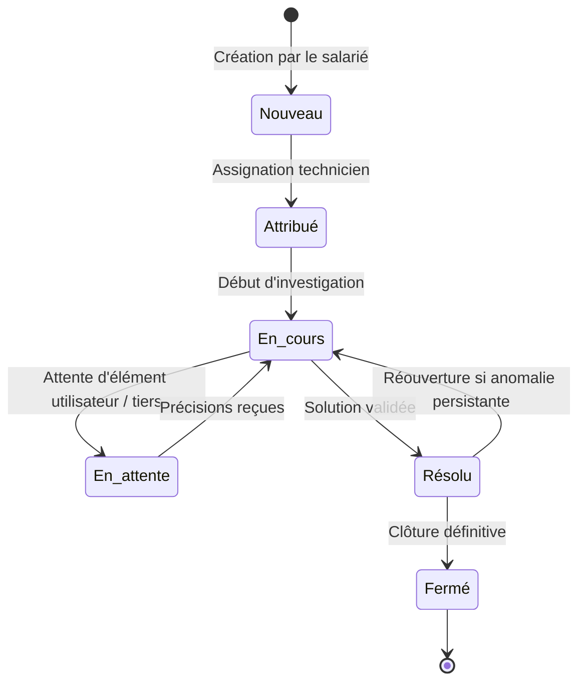
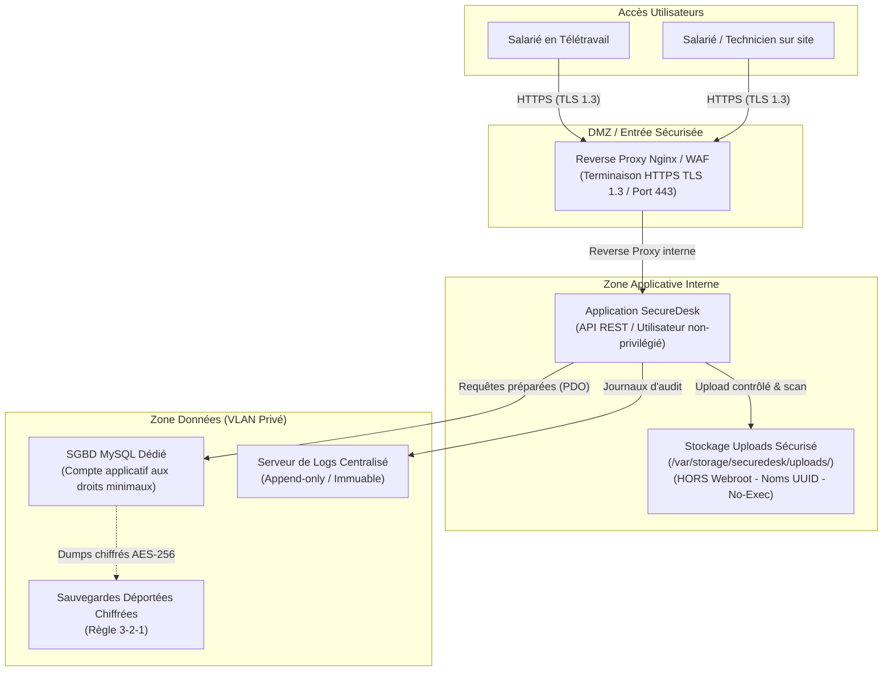

# SecureDesk — Application de Gestion de Tickets Sécurisée

[](https://owasp.org)
[](https://www.cnil.fr)
[](https://github.com)
[](https://github.com)

**SecureDesk** est une plateforme web d'assistance technique interne développée pour les collaborateurs de **NOVATECH SERVICES** (180 salariés). Elle centralise les déclarations d'incidents, optimise le travail des techniciens de support et intègre dès sa conception les exigences de **cybersécurité** (*Security by Design*) et de **protection de la vie privée** (*Privacy by Design*).

---

## 📑 Sommaire

1. [Présentation & Périmètre Métier](#-présentation--périmètre-métier)
2. [Rôles & Habilitations (RBAC)](#-rôles--habilitations-rbac)
3. [Cycle de Vie d'un Incident](#-cycle-de-vie-dun-incident)
4. [Aperçu de l'Interface](#-aperçu-de-linterface)
5. [Architecture Technique Cible (V1)](#-architecture-technique-cible-v1)
6. [Exigences Techniques & Sécurité](#-exigences-techniques--sécurité)
7. [Politique des Données & RGPD](#-politique-des-données--rgpd)
8. [Feuille de Route & Issues GitHub](#-feuille-de-route--issues-github)
9. [Arborescence du Dépôt](#-arborescence-du-dépôt)

---

## 🏢 Présentation & Périmètre Métier

L'application remplace les canaux informels (téléphone, e-mails directs, messageries instantanées) pour apporter :
* **Centralisation & Traçabilité** : Aucun incident oublié, historique horodaté et assignation univoque.
* **Ségrégation des Accès** : Cloisonnement strict entre demandeurs, techniciens et administrateurs.
* **Sécurité des Échanges** : Chiffrement systématique, contrôle strict des pièces jointes et protection contre les attaques web courantes.

---

## 👥 Rôles & Habilitations (RBAC)

| Rôle | Périmètre et Droits applicatifs |
| :--- | :--- |
| **Utilisateur (Salarié)** | Création d'un ticket, choix de catégorie, description du besoin, ajout de pièces jointes autorisées, consultation de ses propres demandes et ajout de réponses/commentaires. |
| **Technicien Support** | Visualisation de la file des tickets assignés, traitement des incidents, changement d'état, rédaction de notes techniques internes, clôture des demandes. |
| **Administrateur Applicatif** | Gestion des comptes (activation/désactivation), attribution des rôles, paramétrage des catégories de tickets, consultation des journaux d'audit applicatifs. |
| **Équipe DevOps / Dev** | Maintenance du code source, gestion de la CI/CD et déploiements sur environnements cloisonnés (sans accès direct aux données de production). |

---

## 🔄 Cycle de Vie d'un Incident



---

## 🖥️ Aperçu de l'Interface

| Module | Aperçu |
| :--- | :--- |
| **Tableau de Bord**<br>Métriques clés, tickets en cours et répartition des urgences |  |
| **Suivi des Demandes**<br>Filtres par statut, catégorie, priorité et assignation |  |
| **Traitement d'un Incident**<br>Échanges avec le demandeur, historique et notes d'intervention |  |
| **Gestion des Utilisateurs**<br>Annuaire interne et contrôle des rôles d'accès |  |

---

## 🏗️ Architecture Technique Cible (V1)

Pour corriger les vulnérabilités de l'architecture initiale (HTTP en clair, root MySQL, uploads dans le webroot, dev/prod mutualisés), l'architecture cible V1 est isolée en zones de confiance :



---

## 🛡️ Exigences Techniques & Sécurité

Toute contribution au projet doit obligatoirement respecter les règles suivantes :

1. **Contrôle d'accès côté serveur (Zero Trust)** :
   * Chaque endpoint d'API ou action vérifie le jeton de session et les permissions associées du demandeur (prévention des IDOR et élévations de privilèges).
2. **Requêtes préparées systématiques** :
   * Utilisation exclusive de requêtes SQL préparées (PDO / ORM sécurisé). Interdiction absolue de la concaténation de variables dans les requêtes.
3. **Téléversement sécurisé étanche** :
   * Stockage des fichiers **hors de la racine web publique**.
   * Renommage systématique des fichiers via un UUID aléatoire.
   * Vérification du type MIME côté serveur (inspection des *magic bytes*) et interdiction des extensions exécutables (`.php`, `.sh`, `.exe`, `.svg`, etc.).
   * Téléchargement uniquement via un contrôleur tampon sécurisé.
4. **Chiffrement & Sécurité des données** :
   * HTTPS obligatoire (TLS 1.3).
   * Hachage des mots de passe en **Argon2id** ou **bcrypt** avec sel unique.
   * Clés d'API et identifiants de BDD chargés via variables d'environnement (`.env`), jamais versionnés dans Git.
5. **Supervision & Imputabilité** :
   * Journalisation des actions sensibles (connexions, modifications de rôles, suppressions) sur un serveur de logs dédié, sans stockage des mots de passe en clair.

---

## 🔒 Politique des Données & RGPD

Conformément au principe de **minimisation des données** (Art. 5 RGPD) :

* **Données strictement autorisées :** Nom, prénom, adresse e-mail professionnelle, service/département, rôle applicatif et détails techniques liés aux incidents.
* **Données exclues du périmètre applicatif :** Numéro de sécurité sociale (NIR), pièces d'identité, coordonnées personnelles (téléphone perso, adresse privée) et géolocalisation GPS.
* **Politique de rétention :**
  * Tickets fermés : Anonymisation après 12 mois.
  * Pièces jointes : Purge automatique après 3 mois suivant la clôture.
  * Journaux de connexion : Rétention maximale de 6 mois.
  * Salariés sortants : Révocation immédiate et suppression après 30 jours.

---

## 📋 Feuille de Route & Issues GitHub

Le développement du projet est découpé en lots de travail configurables en **Issues GitHub** :

* **Infra & Sécurité :** Déploiement du reverse proxy Nginx HTTPS, isolation des environnements Dev/Staging/Prod, gestionnaire de secrets.
* **Backend & API :** Système d'authentification sécurisé, contrôleur RBAC, module de gestion des tickets, contrôleur d'upload étanche.
* **Frontend & UX :** Intégration du tableau de bord, interface de gestion des tickets et formulaires d'administration.
* **Conformité & RGPD :** Mise en place des scripts CRON d'anonymisation et de purge automatique des pièces jointes.

Pour les consignes de développement, la stratégie de branches et le format des commits, consultez le [Guide de Contribution (CONTRIBUTING.md)](CONTRIBUTING.md).

---

## 📂 Arborescence du Dépôt

```text
tickets-management-app/
├── README.md                           # Documentation générale et spécifications du projet
├── CONTRIBUTING.md                     # Guide de contribution, conventions Git et règles de sécurité
├── public/
│   ├── docs/
│   │   └── SecureDesk_Lot_1.docx       # Cahier des charges de référence (Lot 1)
│   └── images/
│       ├── dashboard.png               # Capture écran du tableau de bord
│       ├── all titkets page.png        # Capture écran du listing des tickets
│       ├── edit ticket page.png        # Capture écran du détail / édition d'un ticket
│       └── users page.png              # Capture écran du module utilisateurs
```
