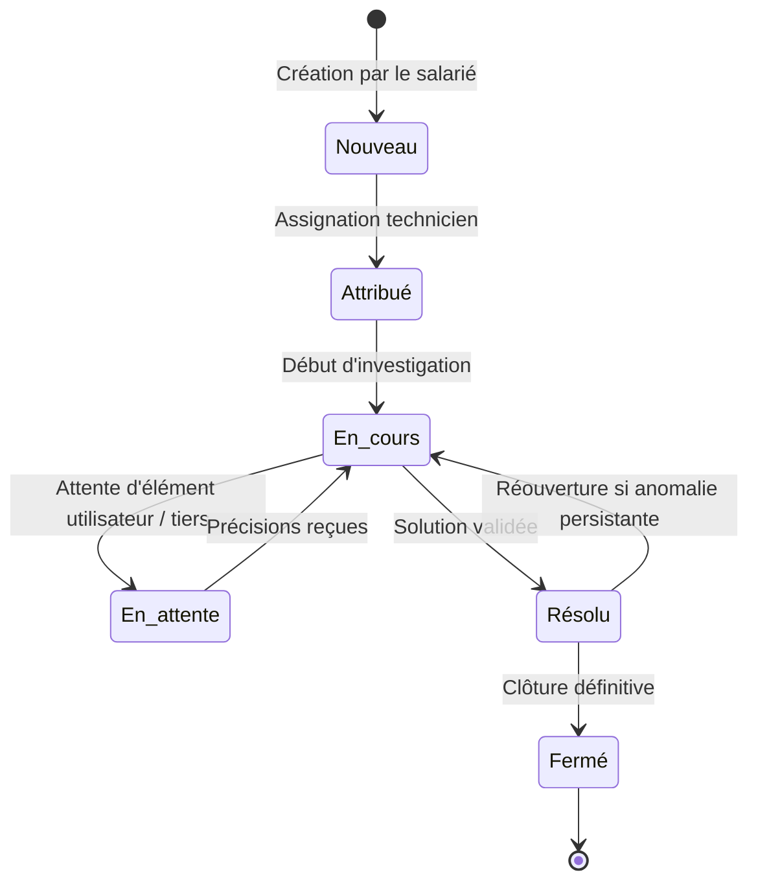
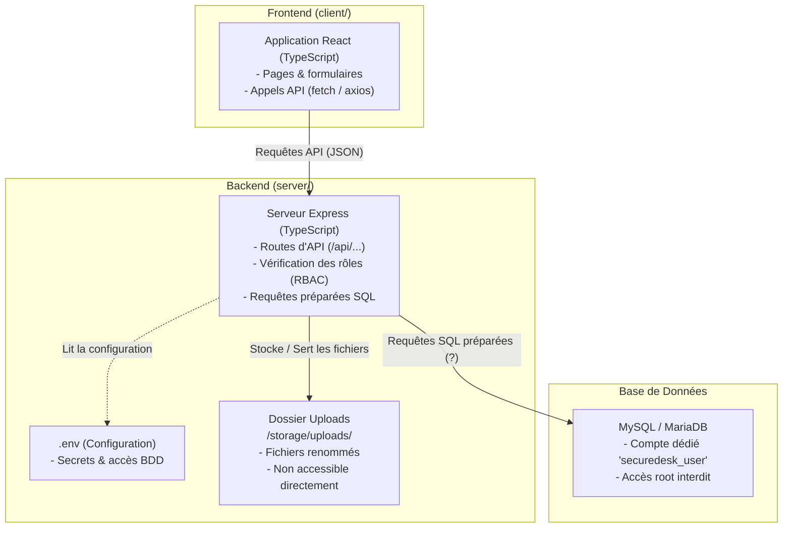

# SecureDesk — Application de Gestion de Tickets Sécurisée

[](https://owasp.org)
[](https://www.cnil.fr)
[](https://github.com)
[](https://github.com)

**SecureDesk** est une plateforme web d'assistance technique interne développée pour les collaborateurs de **NOVATECH SERVICES** (180 salariés). Elle centralise les déclarations d'incidents, optimise le travail des techniciens de support et intègre dès sa conception les exigences de **cybersécurité** (*Security by Design*) et de **protection de la vie privée** (*Privacy by Design*).

---

## 📑 Sommaire

1. [Présentation & Périmètre Métier](#-présentation--périmètre-métier)
2. [Rôles & Habilitations (RBAC)](#-rôles--habilitations-rbac)
3. [Cycle de Vie d'un Incident](#-cycle-de-vie-dun-incident)
4. [Aperçu de l'Interface](#-aperçu-de-linterface)
5. [Architecture Technique Cible (V1)](#-architecture-technique-cible-v1)
6. [Exigences Techniques & Sécurité](#-exigences-techniques--sécurité)
7. [Politique des Données & RGPD](#-politique-des-données--rgpd)
8. [Feuille de Route & Issues GitHub](#-feuille-de-route--issues-github)
9. [Arborescence du Dépôt](#-arborescence-du-dépôt)

---

## 🏢 Présentation & Périmètre Métier

L'application remplace les canaux informels (téléphone, e-mails directs, messageries instantanées) pour apporter :
* **Centralisation & Traçabilité** : Aucun incident oublié, historique horodaté et assignation univoque.
* **Ségrégation des Accès** : Cloisonnement strict entre demandeurs, techniciens et administrateurs.
* **Sécurité des Échanges** : Chiffrement systématique, contrôle strict des pièces jointes et protection contre les attaques web courantes.

---

## 👥 Rôles & Habilitations (RBAC)

| Rôle | Périmètre et Droits applicatifs |
| :--- | :--- |
| **Utilisateur (Salarié)** | Création d'un ticket, choix de catégorie, description du besoin, ajout de pièces jointes autorisées, consultation de ses propres demandes et ajout de réponses/commentaires. |
| **Technicien Support** | Visualisation de la file des tickets assignés, traitement des incidents, changement d'état, rédaction de notes techniques internes, clôture des demandes. |
| **Administrateur Applicatif** | Gestion des comptes (activation/désactivation), attribution des rôles, paramétrage des catégories de tickets, consultation des journaux d'audit applicatifs. |
| **Équipe DevOps / Dev** | Maintenance du code source, gestion de la CI/CD et déploiements sur environnements cloisonnés (sans accès direct aux données de production). |

---

## 🔄 Cycle de Vie d'un Incident



---

## 🖥️ Aperçu de l'Interface

| Module | Aperçu |
| :--- | :--- |
| **Tableau de Bord**<br>Métriques clés, tickets en cours et répartition des urgences |  |
| **Suivi des Demandes**<br>Filtres par statut, catégorie, priorité et assignation |  |
| **Traitement d'un Incident**<br>Échanges avec le demandeur, historique et notes d'intervention |  |
| **Gestion des Utilisateurs**<br>Annuaire interne et contrôle des rôles d'accès |  |

---

## 🏗️ Architecture Technique Cible

Pour corriger les failles du système initial (connexion en `root` MySQL, HTTP en clair, uploads dans le dossier public, secrets dans Git), l'architecture repose sur un modèle simple : **un frontend React et une API Express en TypeScript**.



---

## Exigences Techniques & Sécurité (Simples & Concrètes)

1. **Pas de compte root** :
   * L'application se connecte à MySQL avec un utilisateur dédié (`securedesk_user`) ayant uniquement les droits utiles (`SELECT`, `INSERT`, `UPDATE`, `DELETE`).
2. **Pas d'injections SQL (Requêtes préparées)** :
   * Toujours utiliser le mode préparé avec des paramètres `?` :  
     `await db.execute('SELECT * FROM tickets WHERE id = ?', [ticketId])`
   * Ne jamais concaténer de variable directement dans la chaîne SQL (`"WHERE id = " + id` est interdit).
3. **Contrôle des rôles côté serveur (RBAC)** :
   * Le serveur vérifie systématiquement le rôle de l'utilisateur connecté avant d'exécuter une action (un utilisateur standard ne doit pas pouvoir modifier le statut d'un ticket ou voir les tickets des autres).
4. **Téléversement de fichiers sécurisé** :
   * Enregistrer les fichiers dans un dossier séparé `storage/uploads/` (hors du dossier public du frontend).
   * Renommer le fichier à l'enregistrement (ex: avec un identifiant unique ou un timestamp) pour éviter d'écraser des fichiers existants.
   * N'autoriser que les extensions inoffensives (`.pdf`, `.png`, `.jpg`).
   * Distribuer les fichiers via une route Express contrôlée (ex: `GET /api/tickets/:id/file`).
5. **Mots de passe protégés** :
   * Toujours hasher les mots de passe avec `bcrypt` (`bcrypt.hash`) à la création du compte et vérifier avec `bcrypt.compare` à la connexion.
   * Aucun mot de passe en clair dans la base de données.
6. **Gestion des secrets dans `.env`** :
   * Les identifiants de la base de données sont stockés dans un fichier `.env` local.
   * Ce fichier `.env` est ajouté à `.gitignore` et ne doit jamais être envoyé sur GitHub.
7. **Traçabilité des actions sensibles** :
   * Enregistrer une trace lors des actions importantes (connexion, suppression, changement de rôle) dans une table `logs` :  
     `INSERT INTO logs (user_id, action, date) VALUES (?, ?, NOW())`.

---

## 🔒 Politique des Données & RGPD

Conformément au principe de **minimisation des données** (Art. 5 RGPD) :

* **Données autorisées :** Nom, prénom, email professionnel, service, rôle et description du problème informatique.
* **Données interdites :** Numéro de sécurité sociale (NIR), photos d'identité, coordonnées personnelles (adresse privée, téléphone personnel) et géolocalisation.
* **Rétention :** Les tickets résolus et leurs pièces jointes doivent pouvoir être archivés ou supprimés après un délai défini.

---

## Feuille de Route par Étapes

Le projet vas être développé pas à pas de manière très progressive :

* **Étape 1 — Base de données & Connexion :** Créer la base MySQL, l'utilisateur dédié et tester la connexion depuis un fichier `db.ts` avec `.env`.
* **Étape 2 — Authentification simple :** Créer l'inscription/connexion avec hash `bcrypt`, et le formulaire de login côté React.
* **Étape 3 — Gestion des tickets :** Créer les routes pour lister et ajouter des tickets, et afficher la liste côté React.
* **Étape 4 — Pièces jointes :** Ajouter l'envoi d'un fichier avec `multer` et son téléchargement sécurisé.
* **Étape 5 — Rôles & Historique :** Restreindre certaines actions aux techniciens/admins et enregistrer les actions dans une table `logs`.

Pour les consignes de travail en équipe et l'usage de Git, consultez le [Guide de Contribution (CONTRIBUTING.md)](CONTRIBUTING.md).

---

## Structure 

Une organisation légère et directe, facile à prendre en main :

```text
tickets-management-app/
├── client/                     # Frontend React (TypeScript + Vite)
│   ├── src/
│   │   ├── components/         # Composants réutilisables (Navbar, TicketCard...)
│   │   ├── pages/              # Pages (Login.tsx, Dashboard.tsx, TicketDetail.tsx...)
│   │   ├── App.tsx             # Routes de navigation
│   │   └── main.tsx            # Démarrage de React
│   ├── package.json
│   └── tsconfig.json
├── server/                     # Backend Express (TypeScript)
│   ├── src/
│   │   ├── db.ts               # Connexion à la base MySQL (mysql2/promise)
│   │   ├── routes.ts           # Définition des routes de l'API (/api/tickets, /api/auth...)
│   │   └── server.ts           # Démarrage du serveur Express
│   ├── storage/
│   │   └── uploads/            # Fichiers envoyés par les utilisateurs (sécurisés)
│   ├── .env.example            # Modèle de configuration BDD
│   ├── package.json
│   └── tsconfig.json
├── public/                     # Ressources du projet
│   ├── docs/                   # Sujet officiel (SecureDesk_Lot_1.docx)
│   └── images/                 # Captures d'écran et maquettes de l'interface
├── README.md                   # Présentation générale
└── CONTRIBUTING.md             # Guide Git et règles d'équipe
```
